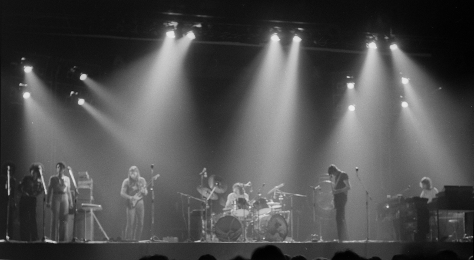

Mine... and yours...
Two names for the same ground
We drew a line in the sand at dawn
And the tide came in, and the line was gone
But we drew it again, and again
Never asking why

Here... and there...
The same rain on both sides
A flag on a hill and a voice on the air
Says the danger’s out there, it’s always out there
So we wait in the cold for an order to come
From a room far away

Near... and far...
Who decides which one we are?
The man across the river
Has a mother too
And he’s waiting for a letter
Like me, like you

Up... and down...
The numbers on the screen
Someone gains when the bridges burn
Someone pays and we never learn
Hands that built the walls
Never live behind them

“I don’t know... I suppose it was always like that.
You just did what you were told, didn’t you?”

Then... and now...
The old song, a new key
And the water runs like it always ran
It doesn’t know where one shore began
It only knows the way to the sea
It only knows the sea
