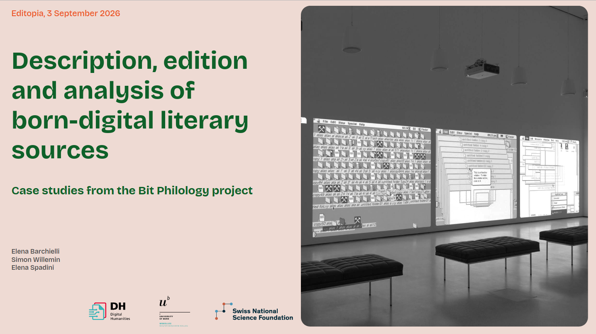

[no-lead]The team presented a paper at the conference Editopia, held 2–4 September 2026 at the University of Wuppertal.

The slides are available at: https://doi.org/10.5281/zenodo.23196580.

Conference website: [editopia2026.i-d-e.de](https://editopia2026.i-d-e.de/)

